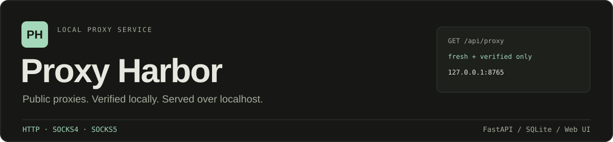
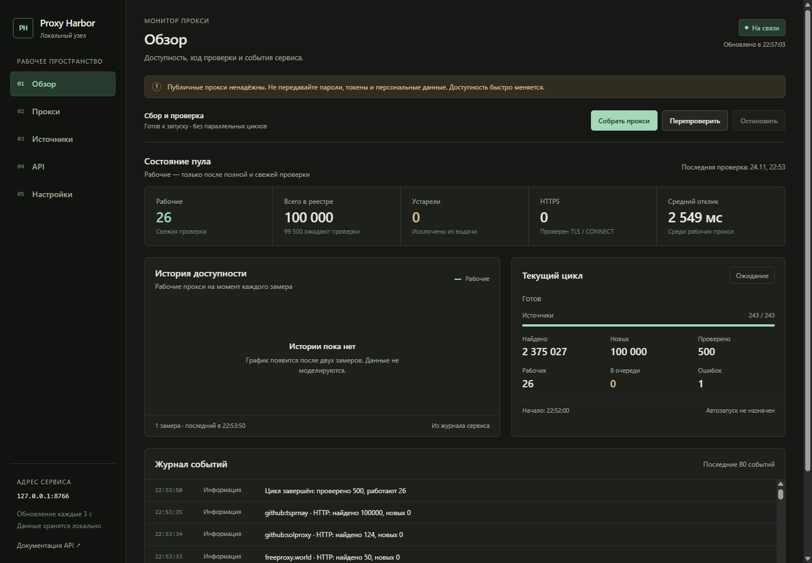
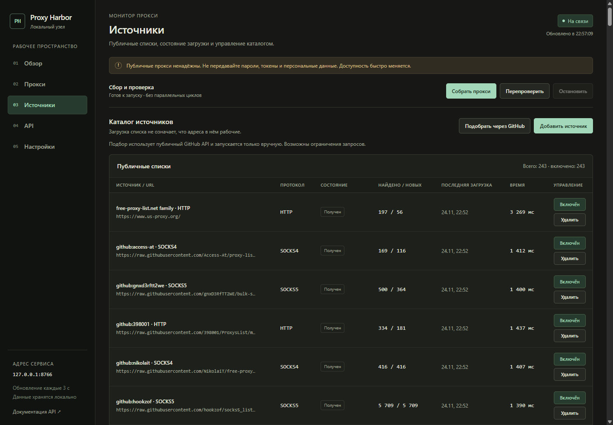
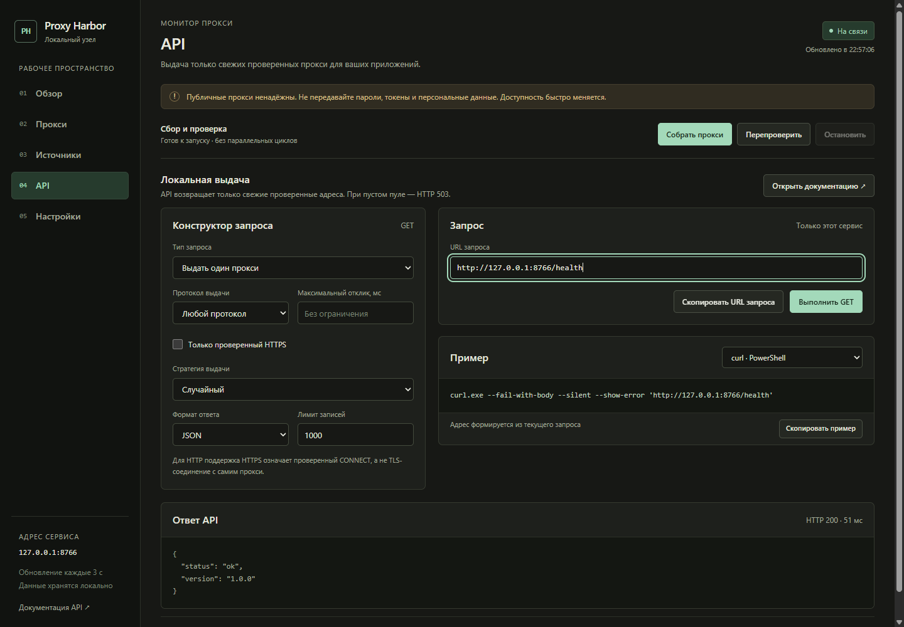
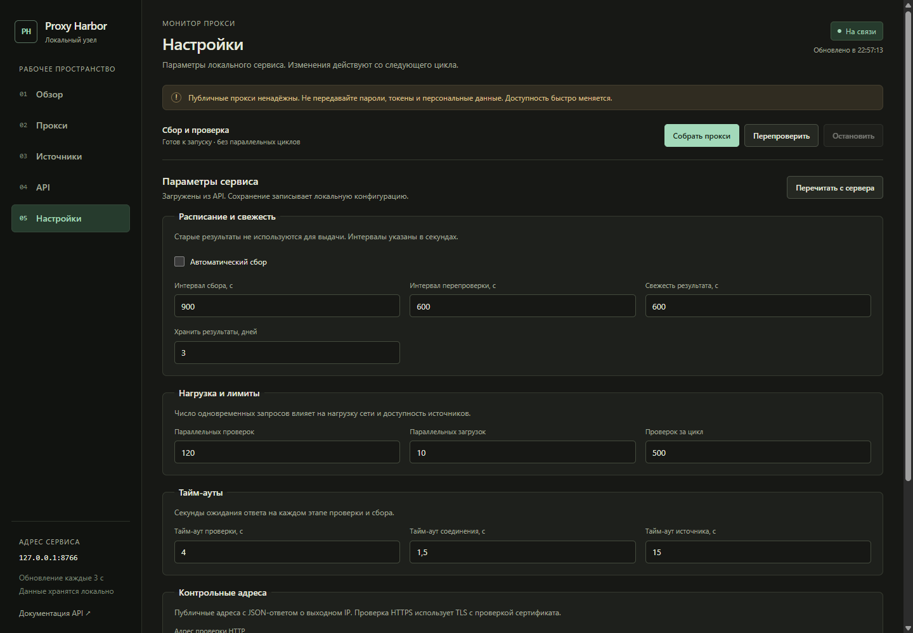

<p align="center">
  
</p>

<p align="center">
  
  <a href="LICENSE"></a>
  
  
</p>

<p align="center">
  <a href="#быстрый-запуск">Быстрый запуск</a> ·
  <a href="#локальный-api">API</a> ·
  <a href="docs/USAGE.md">Полное руководство</a> ·
  <a href="docs/SOURCES.md">Каталог источников</a>
</p>

**Proxy Harbor** собирает публичные прокси, удаляет дубли, проверяет реальное проксирование и выдаёт свежие рабочие адреса через локальный API. Управление — через dashboard. Данные остаются на вашей машине.

> Бесплатные публичные прокси недоверенные и нестабильные. Не передавайте через них пароли, платёжные данные, токены и персональную информацию. Проверка подтверждает доступность в конкретный момент, а не анонимность или безопасность владельца.

## Обзор



- **243 стартовых feed-URL** из аудита публичных списков. Издательские метки и реальные независимые наборы данных — не одно и то же.
- **HTTP, SOCKS4, SOCKS5**, публичные IPv4 и IPv6 endpoints.
- **Полноценная V2-проверка:** IP-probe и свежий nonce на другом Host; для HTTPS — проверка сертификатов конечных серверов.
- **SQLite WAL:** уникальность protocol + IP + port, происхождение адресов и история проверок.
- **Свежая выдача:** pending, dead, stale и старые версии проверки не попадают в `/api/proxy`.
- **Управление из UI:** сбор, остановка, повторная проверка, поиск, фильтры, импорт, экспорт, источники и настройки.
- **Без внешнего frontend-сервера:** HTML/CSS/JS и Swagger UI обслуживаются локально. Node.js и Docker для запуска не нужны.

### Источники



Каталог расширяется через UI и API. GitHub discovery ограничен по времени и числу запросов; ошибки доступа и rate limits не обходятся. [Аудит источников](docs/SOURCES.md) сохраняет URL, время загрузки, статус HTTP, количество публичных кандидатов и checksum.

**Доступный feed не означает рабочий прокси.** Каждый endpoint отдельно проверяется перед выдачей.

## Быстрый запуск

Нужны **Python 3.11+** и доступ в Интернет для установки зависимостей, загрузки feeds и проверки адресов. Основное проверенное окружение — Windows x64 / Python 3.14.

```bash
git clone https://github.com/FROFI10/proxy-harbor.git
cd proxy-harbor
```

### Windows

Дважды нажмите **`start.bat`**. Если окружения нет, скрипт установит зависимости в `.venv`, запустит сервер и откроет браузер после готовности приложения.

Или из PowerShell в папке проекта:

```powershell
.\start.bat
```

Ручной запуск, другой порт или только установка:

```powershell
.\setup.bat
.\.venv\Scripts\python.exe run.py --open-browser
.\.venv\Scripts\python.exe run.py --port 8766 --open-browser
```

### Linux / macOS

```bash
bash start.sh --open-browser
```

Исходники кроссплатформенные; автоматизированные проверки в этом выпуске выполнены на Windows. Запуск на другой ОС следует дополнительно проверить в её окружении.

### Адреса по умолчанию

| Назначение | URL |
|---|---|
| Dashboard | `http://127.0.0.1:8765/` |
| Один прокси | `http://127.0.0.1:8765/api/proxy` |
| OpenAPI / Swagger | `http://127.0.0.1:8765/docs` |
| Health | `http://127.0.0.1:8765/health` |

При первом запуске API может вернуть **503**, пока нет свежих проверенных адресов. Это ожидаемое состояние: демонстрационные прокси в пул не подставляются.

## Локальный API



Один адрес в JSON:

```bash
curl --fail "http://127.0.0.1:8765/api/proxy"
```

HTTP-прокси с подтверждённым HTTPS, текстом:

```bash
curl --fail "http://127.0.0.1:8765/api/proxy?protocol=http&https_only=true&strategy=best&format=text"
```

В PowerShell используйте `curl.exe`, чтобы не попасть на одноимённый alias.

| Параметр | Значения |
|---|---|
| `protocol` | `http`, `socks4`, `socks5` |
| `https_only` | `true` — нужен подтверждённый HTTPS/TLS |
| `strategy` | `random`, `best`, `round_robin` |
| `max_latency_ms` | верхний предел задержки |
| `format` | `json`, `text` (URL), `address` (IP:port) |

JSON содержит `id`, `url`/`proxy`, `address`, `protocol`, `latency_ms`, `supports_https`, `exit_ip`, `last_checked` и `validation_version`.

Пакет адресов: `/api/proxies/batch?count=10`. Просмотр: `/api/proxies`. Экспорт: `/api/proxies/export`. Все [методы, примеры Python, параметры и ошибки](docs/USAGE.md#8-управление-через-api) описаны в руководстве и `/docs`.

**Порт 8765 — API выдачи, не forward proxy.** Приложение сначала получает URL, затем подключается к полученному upstream через свою HTTP-библиотеку.

## Настройки и хранение



- `config.json` — локальные настройки; пример — [config.example.json](config.example.json).
- `sources.json` — стартовый каталог, обязательный файл первого запуска.
- `data/sources.json` — изменённый пользователем каталог; имеет приоритет после сохранения.
- `data/proxies.sqlite3` — база.
- `logs/proxyharbor.log` — ротируемый журнал.

Runtime-файлы, `.env`, виртуальное окружение, базы и сырые локальные отчёты исключены из Git. Путь к данным вычисляется относительно папки проекта, не рабочей директории терминала.

Остановить сервер — **Ctrl+C** в его консоли. `POST /api/stop` останавливает текущий цикл, но не выключает сохранённое автоматическое расписание.

## Проверки разработки

В активированном окружении проекта:

```bash
python -m pip install -r requirements-dev.txt
python -m playwright install chromium
python -m pytest -q
python -m ruff check proxyharbor tests scripts run.py
```

Тесты используют изолированные SQLite-базы и контролируемые HTTP/SOCKS/TLS-серверы. Браузерные тесты выполняют реальные сценарии Chromium. Стартовый каталог проверяется отдельным fresh-clone regression.

Положительный тест прокси не гарантирует будущую доступность и не отменяет ограничений проверочного provider. HTTPS capability отделена от HTTP; self-signed сертификаты не принимаются ради положительного результата.

## Документация

- [Полное руководство](docs/USAGE.md): запуск, запросы, фильтры, импорт/экспорт, отчёты, настройка скорости, backup и диагностика.
- [Источники и аудит](docs/SOURCES.md).
- [Сторонние компоненты](docs/THIRD_PARTY.md).
- [MIT License](LICENSE).

Проект не является VPN, средством TLS MITM или обхода авторизации. Loopback не заменяет аутентификацию на недоверенной многопользовательской машине.
